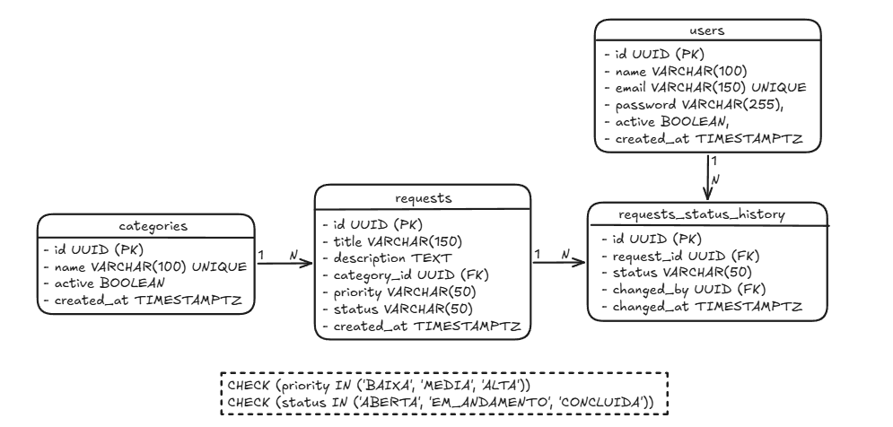

# Central de Solicitações

API para gerenciamento de solicitações internas, desenvolvida como parte do desafio técnico do processo seletivo da **Loading Desenvolvimento Jr.**

O projeto tem como objetivo centralizar o registro e o acompanhamento de solicitações, permitindo organizar demandas por categoria, prioridade e status, além de manter o histórico de suas alterações.

> **Status:** Em desenvolvimento.

---

## Objetivo

Construir uma aplicação para gerenciar solicitações internas de uma organização, substituindo controles informais por um fluxo estruturado e persistente.

O fluxo principal de uma solicitação contempla três etapas:

`ABERTA → EM_ANDAMENTO → CONCLUIDA`

A aplicação deverá garantir que as transições respeitem essa sequência, evitando mudanças inválidas no estado das solicitações.

---

## Tecnologias

| Categoria | Tecnologia |
|---|---|
| Linguagem | Java 25 |
| Framework | Spring Boot 4 |
| Persistência | Spring Data JPA / Hibernate |
| Banco de dados | PostgreSQL 17 |
| Versionamento do banco | Flyway |
| Build | Maven |
| Ambiente do banco | Docker Compose |
| Front-End planejado | HTML, CSS e JavaScript |

---

## Arquitetura e organização

O Back-End utiliza uma organização modular orientada aos domínios da aplicação, agrupando componentes relacionados à mesma responsabilidade de negócio.

Estrutura geral:

```text
src/
├── main/
│   ├── java/
│   │   └── com/fcolucasvieira/central_solicitacoes_api/
│   │       ├── request/
│   │       ├── category/
│   │       └── user/
│   │
│   └── resources/
│       ├── db/
│       │   └── migration/
│       └── application.yaml
│
└── test/
```

Os módulos representam as principais áreas do sistema:

- **Request:** gerenciamento das solicitações, seus status e histórico.
- **Category:** organização das categorias utilizadas pelas solicitações.
- **User:** representação dos usuários do sistema.

A estrutura busca manter as responsabilidades organizadas por domínio, facilitando a manutenção e a evolução da aplicação.

---

## Modelagem do banco de dados

O modelo relacional foi estruturado para representar as principais entidades do domínio e preservar a integridade dos dados e dos relacionamentos.

O diagrama abaixo apresenta o schema inicial da aplicação:



As principais entidades são:

- **Request:** representa uma solicitação, contendo título, descrição, categoria, prioridade e status atual.
- **Category:** representa as categorias utilizadas para classificar as solicitações.
- **User:** representa os usuários do sistema.
- **RequestHistoryStatus:** registra os status alcançados por uma solicitação e o usuário responsável pela alteração.

O histórico é mantido separadamente da solicitação, permitindo preservar os registros das mudanças de status ao longo do tempo.

---

## Configuração e execução

### Pré-requisitos

- JDK 25;
- Maven;
- Docker e Docker Compose;
- Git.

### 1. Clonar o repositório

```bash
git clone <URL_DO_REPOSITORIO>
cd central-solicitacoes-api
```

### 2. Configurar as variáveis de ambiente

Crie um arquivo `.env` na raiz do projeto, seguindo o modelo disponível em `.env.example`.

```env
POSTGRES_DB=central_solicitacoes
POSTGRES_USER=postgres
POSTGRES_PASSWORD=sua_senha
```

### 3. Iniciar o banco de dados

```bash
docker compose up -d
```

O PostgreSQL será iniciado em um container Docker, com persistência dos dados por meio de um volume nomeado.

### 4. Executar a aplicação

Com o banco de dados em execução, inicie a aplicação pela sua IDE ou utilizando o Maven:

```bash
./mvnw spring-boot:run
```

No Windows:

```bash
mvnw.cmd spring-boot:run
```

As migrations do Flyway são responsáveis pelo versionamento e pela criação da estrutura do banco de dados.

---

## Funcionalidades

O projeto está em desenvolvimento. Até o momento, sua estrutura contempla:

- [x] Configuração do PostgreSQL com Docker Compose.
- [x] Configuração de conexão com o banco por variáveis de ambiente.
- [x] Versionamento do schema com Flyway.
- [x] Modelagem inicial das entidades e relacionamentos.
- [x] Definição dos enums de prioridade e status.
- [ ] Cadastro e consulta de solicitações.
- [ ] Filtros por status e prioridade.
- [ ] Implementação das regras de transição de status.
- [ ] Registro do histórico de alterações.
- [ ] Testes automatizados.
- [ ] Integração com a interface web.

---

## Autor

**Lucas Vieira**:
Estudante de Engenharia de Computação — UFC Sobral

- GitHub: [github.com/fcolucasvieira](https://github.com/fcolucasvieira)
- LinkedIn: [linkedin.com/in/fco-lucas-vieira](https://www.linkedin.com/in/fco-lucas-vieira/)