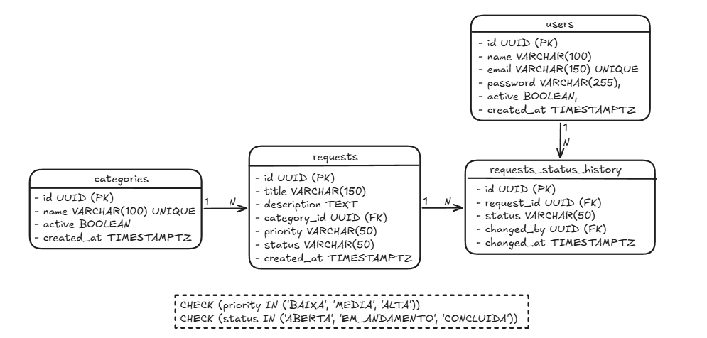

# Central de Solicitações

Aplicação Full Stack para gerenciamento de solicitações internas, desenvolvida como parte do desafio técnico do processo seletivo da **Loading Desenvolvimento Jr.**

O sistema permite centralizar o registro e o acompanhamento de solicitações, organizando demandas por categoria, prioridade e status, além de manter o histórico de suas alterações.

<details>
<summary>Informações do projeto</summary>

- **Versão:** 1.1.0
- **Status:** Concluído
- **Tipo:** Aplicação Full Stack
- **Back-End:** Java 25 e Spring Boot 4
- **Front-End:** HTML5, CSS3 e JavaScript (ES6 Modules)
- **Banco de dados:** PostgreSQL 17

</details>

## Aplicação em Produção

A aplicação está hospedada em ambientes de produção, permitindo acessar a interface web e a documentação da API sem necessidade de configuração ou execução local.

| Recurso | Endereço |
|---|---|
| **Aplicação Web (Front-End)** | [Acessar Central de Solicitações](https://central-solicitacoes-api-frontend.vercel.app/) |
| **API (Back-End)** | [Acessar API](https://central-solicitacoes-api.onrender.com/) |
| **Documentação Swagger UI** | [Explorar documentação da API](https://central-solicitacoes-api.onrender.com/swagger-ui/index.html) |

---

## Objetivo

Construir uma aplicação para gerenciar solicitações internas de uma organização, substituindo controles informais por um fluxo estruturado e persistente.

O fluxo principal de uma solicitação contempla três etapas:

`ABERTA → EM_ANDAMENTO → CONCLUIDA`

A aplicação garante que as transições respeitem essa sequência, evitando mudanças inválidas no estado das solicitações.

---

## Tecnologias

| Categoria | Tecnologia |
|---|---|
| Linguagem Back-End | Java 25 |
| Framework Back-End | Spring Boot 4 |
| Persistência | Spring Data JPA / Hibernate |
| Banco de dados | PostgreSQL 17 |
| Versionamento do banco | Flyway |
| Segurança | Spring Security / JWT |
| Documentação da API | Springdoc OpenAPI / Swagger UI |
| Build | Maven |
| Containerização | Docker / Docker Compose |
| Front-End | HTML5, CSS3 e JavaScript |
| Organização do Front-End | ES6 Modules |
| Hospedagem Back-End | Render |
| Hospedagem Front-End | Vercel |
| Versionamento | Git / GitHub |

---

## Arquitetura e organização

O Back-End utiliza uma organização modular orientada aos domínios da aplicação, agrupando componentes relacionados à mesma responsabilidade de negócio.

Estrutura geral:

```text
src/
├── main/
│   ├── java/
│   │   └── com/fcolucasvieira/central_solicitacoes_api/
│   │       ├── auth/
│   │       ├── config/
│   │       ├── exception/
│   │       ├── jwt/
│   │       ├── request/
│   │       ├── category/
│   │       └── user/
│   │
│   └── resources/
│       ├── db/
│       │   └── migration/
│       └── application.yaml/
│
└── test/
```

Os módulos representam as principais áreas do sistema:

- **Auth:** registro e autenticação de usuários com geração de token JWT.
- **Config:** configurações de segurança (Spring Security) e documentação (Swagger/OpenAPI).
- **Exception:** tratamento global de exceções com respostas padronizadas.
- **JWT:** serviço de geração e validação de tokens e filtro de autenticação por requisição.
- **Request:** gerenciamento das solicitações, seus status e histórico.
- **Category:** organização das categorias utilizadas pelas solicitações.
- **User:** representação dos usuários do sistema.

A estrutura busca manter as responsabilidades organizadas por domínio, facilitando a manutenção e a evolução da aplicação.

---

## Modelagem do banco de dados

O modelo relacional foi estruturado para representar as principais entidades do domínio e preservar a integridade dos dados e dos relacionamentos.

O diagrama abaixo apresenta o schema inicial da aplicação:



As principais entidades são:

- **Request:** representa uma solicitação, contendo título, descrição, categoria, prioridade e status atual.
- **Category:** representa as categorias utilizadas para classificar as solicitações.
- **User:** representa os usuários do sistema.
- **RequestStatusHistory:** registra os status alcançados por uma solicitação e o usuário responsável pela alteração.

O histórico é mantido separadamente da solicitação, permitindo preservar os registros das mudanças de status ao longo do tempo.

---

## Configuração e execução local

### Pré-requisitos

- JDK 25;
- Maven;
- Docker e Docker Compose;
- Git.

### 1. Clonar o repositório

```bash
git clone https://github.com/fcolucasvieira/central-solicitacoes-api.git
cd central-solicitacoes-api
```

### 2. Configurar as variáveis de ambiente

Crie um arquivo `.env` na raiz do projeto, seguindo o modelo disponível em `.env.example`.

```env
POSTGRES_DB=central_solicitacoes
POSTGRES_USER=postgres
POSTGRES_PASSWORD=sua_senha

JWT_SECRET_KEY=sua_chave_secreta_com_no_minimo_32_caracteres
EXPIRATION_MS=86400000
JWT_ISSUER=central-solicitacoes-api
```

> A chave `JWT_SECRET_KEY` deve ter no mínimo 32 caracteres para garantir a segurança da assinatura HMAC-SHA256.

### 3. Iniciar o banco de dados

```bash
docker compose up -d
```

O PostgreSQL será iniciado em um container Docker, com persistência dos dados por meio de um volume nomeado.

### 4. Executar a aplicação

Com o banco de dados em execução, inicie a aplicação pela sua IDE ou utilizando o Maven:

```bash
./mvnw spring-boot:run
```

No Windows:

```bash
mvnw.cmd spring-boot:run
```

As migrations do Flyway são responsáveis pelo versionamento e pela criação da estrutura do banco de dados.

---

## Documentação da API (Swagger / OpenAPI)

A aplicação conta com documentação interativa gerada por meio do **Springdoc OpenAPI e Swagger UI**.

A documentação disponibiliza informações sobre os endpoints, parâmetros, esquemas de requisição e resposta (Request/Response DTOs), exemplos de utilização e códigos de status HTTP.

### Acessos

**Ambiente local:**

- Swagger UI: `http://localhost:8080/swagger-ui/index.html`
- OpenAPI JSON: `http://localhost:8080/v3/api-docs`

**Ambiente de produção:**

- [Swagger UI — Produção](https://central-solicitacoes-api.onrender.com/swagger-ui/index.html)
- [API — Produção](https://central-solicitacoes-api.onrender.com/)

### Autenticação no Swagger UI

Os endpoints protegidos exigem um token JWT. Para autenticar no Swagger UI:

1. Utilize `POST /auth/register` ou `POST /auth/login` para obter um token.
2. Clique no botão **Authorize** no topo da página.
3. No campo **Value**, informe o token JWT (sem o prefixo `Bearer`).
4. Clique em **Authorize** e feche o modal.

Os endpoints protegidos passarão a enviar o header `Authorization: Bearer <token>` automaticamente.

### Utilização de Inteligência Artificial

Durante a construção da documentação Swagger/OpenAPI, foi utilizado auxílio de Inteligência Artificial para estruturar e aprimorar as descrições dos endpoints, incluindo exemplos de requisições e respostas, bem como a representação dos respectivos DTOs.

O uso da ferramenta teve como finalidade melhorar a clareza, a padronização e a compreensão da documentação disponibilizada aos consumidores da API.

As definições foram integradas ao projeto e devem representar os contratos efetivamente implementados pela aplicação.

---

## Interface Web (Front-End)

A aplicação conta com uma interface web moderna, responsiva e desenvolvida com **HTML5 semântico, CSS3 e JavaScript puro (ES6 Modules)**, aplicando a identidade visual e as diretrizes do Brandbook da **Loading Desenvolvimento Jr.**

**Acesse a aplicação:** [Central de Solicitações — Front-End](https://central-solicitacoes-api-frontend.vercel.app/)

### Funcionalidades da Interface

- **Autenticação:** telas de Login e Criação de Conta integradas à API via JWT, com persistência da sessão no `localStorage` e fluxo de logout.
- **Painel de Solicitações:** listagem paginada consumindo `GET /requests`, com badges temáticos de status, prioridade e data formatada.
- **Filtros Combináveis e Busca:** filtro simultâneo por Status, Prioridade, Categoria (carregada dinamicamente via `GET /categories`) e busca textual no título com técnica de debounce (350ms).
- **Cadastro Dinâmico (RF01):** modal flutuante para abertura de novas demandas (`POST /requests`) com validação de campos e feedback amigável.
- **Transição de Status (RF04):** botões de ação contextuais na tabela para avançar o fluxo estrito (`ABERTA → EM_ANDAMENTO → CONCLUIDA`) com chamadas `PATCH /requests/{id}/status`.
- **Linha do Tempo de Histórico (Opcional):** modal com timeline cronológica das alterações de status, exibindo o responsável e o timestamp (`GET /requests/{id}/history`).
- **Fluidez e UX:** notificações flutuantes (*Toasts*) para feedback de operações e estados de *Loading* e *Empty State*.

### Identidade Visual e Utilização de Inteligência Artificial

O desenvolvimento da interface web contou com auxílio de Inteligência Artificial, especialmente na construção e implementação dos componentes visuais, organização das telas e aplicação da identidade visual da Loading Desenvolvimento Jr.

A ferramenta foi utilizada como apoio durante a implementação da interface, considerando as referências visuais e as diretrizes de identidade da organização.

A integração da interface com a API, os fluxos de utilização e a validação do comportamento da aplicação foram conduzidos durante o desenvolvimento do projeto.

### Como Executar o Front-End Localmente

1. Certifique-se de que a API Back-End esteja em execução na porta `8080`.
2. Abra a pasta do projeto no **VS Code**.
3. Com a extensão **Live Server** instalada, clique com o botão direito no arquivo `frontend/index.html` e selecione **Open with Live Server**.
4. A aplicação será aberta no navegador em `http://127.0.0.1:5500/frontend/index.html`.

---

## Tratamento de Concorrência (Optimistic Locking)

Para assegurar a consistência dos dados e a integridade das transições de status em cenários de requisições simultâneas, a aplicação adota **bloqueio otimista (*Optimistic Locking*)**:

- **Mecanismo:** a entidade `Request` possui um atributo `@Version private Long version`, mapeado para a coluna `version` gerenciada no schema via migração do Flyway (`V3`).
- **Comportamento Concorrente:** caso duas instâncias ou usuários tentem atualizar a mesma solicitação simultaneamente, o Hibernate detecta o conflito de versão e lança a exceção `ObjectOptimisticLockingFailureException`.
- **Tratamento Global:** a exceção é capturada pelo `GlobalExceptionHandler` e devolvida com status HTTP `409 Conflict`, no padrão RFC 7807 (`ProblemDetail`), impedindo sobrescrita inadvertida e garantindo feedback transparente para que o cliente recarregue o recurso.

---

## Endpoints e Funcionalidades da API

A tabela abaixo sintetiza os principais endpoints disponibilizados pela API:

| Método | Endpoint | Módulo | Descrição | Autenticação |
| :--- | :--- | :--- | :--- | :---: |
| `POST` | `/auth/register` | Auth | Cadastra um novo usuário no sistema e retorna seus dados | Não |
| `POST` | `/auth/login` | Auth | Autentica um usuário existente e emite o token JWT de acesso | Não |
| `POST` | `/categories` | Categorias | Cria uma nova categoria de solicitação | Sim (Bearer) |
| `GET` | `/categories` | Categorias | Lista categorias ativas de forma paginada | Sim (Bearer) |
| `GET` | `/categories/{id}` | Categorias | Consulta os detalhes de uma categoria por ID | Sim (Bearer) |
| `DELETE` | `/categories/{id}` | Categorias | Realiza a exclusão lógica (desativação) de uma categoria | Sim (Bearer) |
| `POST` | `/requests` | Solicitações | Registra uma nova solicitação com status inicial `ABERTA` | Sim (Bearer) |
| `GET` | `/requests` | Solicitações | Lista solicitações com paginação, ordenação decrescente e filtros combináveis | Sim (Bearer) |
| `GET` | `/requests/{id}` | Solicitações | Consulta os detalhes de uma solicitação por ID | Sim (Bearer) |
| `PATCH` | `/requests/{id}/status` | Solicitações | Executa a transição estrita de status (`ABERTA → EM_ANDAMENTO → CONCLUIDA`) | Sim (Bearer) |
| `GET` | `/requests/{id}/history` | Solicitações | Retorna a linha do tempo com o histórico de transições e responsáveis | Sim (Bearer) |

Para consultar parâmetros, exemplos de payloads, esquemas de DTOs e respostas completas, acesse a documentação interativa do Swagger:

[Swagger UI — Produção](https://central-solicitacoes-api.onrender.com/swagger-ui/index.html).

---

## Deploy e Containerização (Docker)

A aplicação foi disponibilizada em ambientes de produção utilizando plataformas de hospedagem em nuvem (PaaS).

### Arquitetura de Produção

- **Back-End — Render:** hospedagem da API Java/Spring Boot, responsável pelo processamento das regras de negócio, autenticação e comunicação com o banco de dados.
- **Front-End — Vercel:** hospedagem da interface web, disponibilizando os recursos estáticos e permitindo a interação com a API em produção.
- **Banco de dados — PostgreSQL:** persistência dos dados utilizados pela aplicação.

### Endereços de Produção

| Componente | Plataforma | Endereço |
|---|---|---|
| Back-End | Render | [central-solicitacoes-api.onrender.com](https://central-solicitacoes-api.onrender.com/) |
| Swagger/OpenAPI | Render | [Documentação da API](https://central-solicitacoes-api.onrender.com/swagger-ui/index.html) |
| Front-End | Vercel | [central-solicitacoes-api-frontend.vercel.app](https://central-solicitacoes-api-frontend.vercel.app/) |

### Containerização

O Back-End conta com suporte para execução em containers Docker.

**Dockerfile Multi-Stage:** utiliza a imagem oficial Eclipse Temurin para compilação com Maven Wrapper e empacotamento em runtime JRE, executando com usuário sem privilégios de root (`appuser`).

### Como construir e executar a imagem Docker localmente

1. **Construir a imagem da API:**

```bash
docker build -t central-solicitacoes-api .
```

2. **Executar a API conectada ao banco local:**

```bash
docker run -p 8080:8080 --name central-api \
  -e POSTGRES_DB=central_solicitacoes \
  -e POSTGRES_USER=postgres \
  -e POSTGRES_PASSWORD=sua_senha \
  -e DB_HOST=host.docker.internal \
  -e JWT_SECRET_KEY=sua_chave_secreta_com_no_minimo_32_caracteres \
  central-solicitacoes-api
```

---

## Autor

**Lucas Vieira**

Estudante de Engenharia de Computação — Universidade Federal do Ceará (UFC), Campus Sobral.

- GitHub: [github.com/fcolucasvieira](https://github.com/fcolucasvieira)
- LinkedIn: [linkedin.com/in/fco-lucas-vieira](https://www.linkedin.com/in/fco-lucas-vieira/)

---

**Desenvolvido como parte do desafio técnico do processo seletivo da Loading Desenvolvimento Jr.**